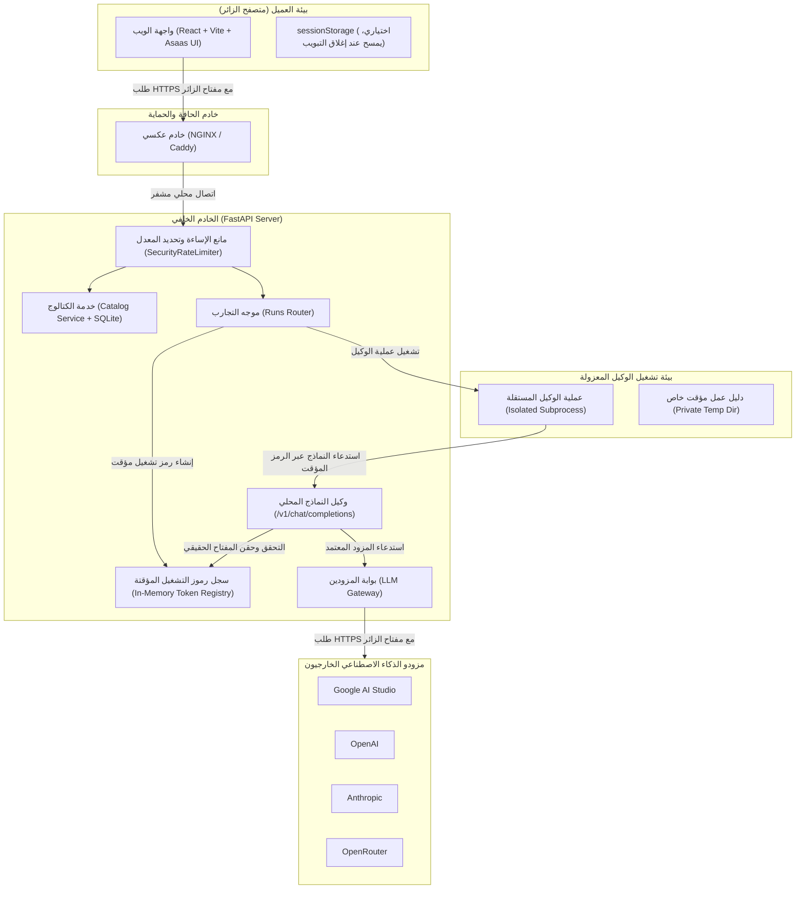
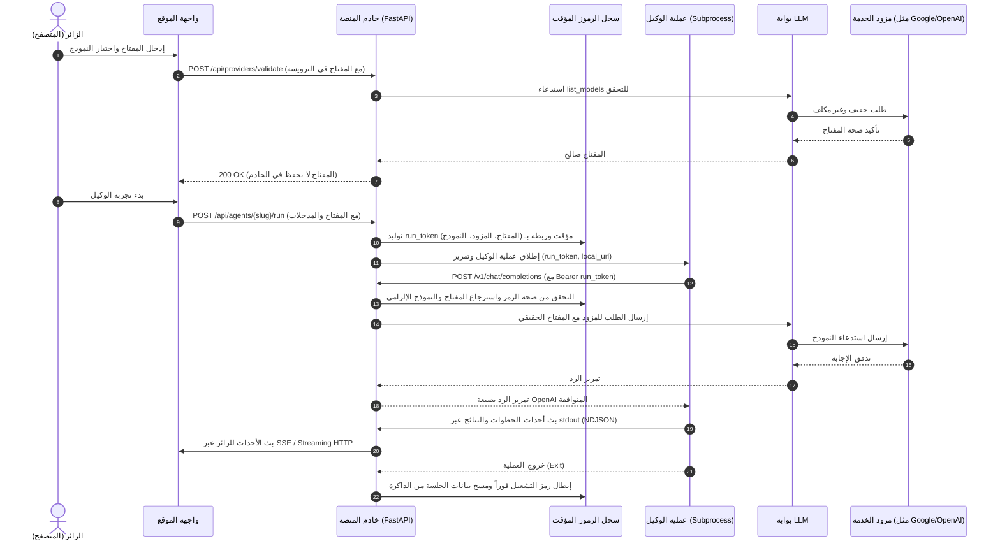

# معمارية منصة وكلاء أساس — System Architecture

يوثق هذا المستند الهيكل المعماري، وحدود الثقة، ودورة حياة المفاتيح وتدفق البيانات لمنصة **وكلاء أساس (ASAAS Agents Platform)**.

---

## 1. النظرة المعمارية العامة (System Overview)

المنصة مصممة وفق نموذج **أحضر مفتاحك الخاص (BYOK)** كمعرض عام لوكلاء الذكاء الاصطناعي مع إمكانية التجربة الحية الفورية دون الحاجة إلى إنشاء حسابات مستخدمين.

---

## 2. حدود الثقة ونموذج الأمان (Trust Boundaries)

### أ. واجهة المتصفح -> الخادم الخلفي (Browser to Backend Boundary)
- **مستوى الثقة:** غير موثوق بالكامل (Untrusted).
- **الضوابط المفروضة:**
  - استخراج عنوان IP الحقيقي عبر `trusted_proxies` فقط، لمنع تزوير ترويسة `X-Forwarded-For`.
  - تطبيق حدود الطلبات متعددة الطبقات (فحص المفتاح: 10/دقيقة، اختبار الاتصال: 6/دقيقة، بدء التشغيل: 10/دقيقة، سقف يومي: 50/يوم).
  - حظر الطلبات التي يتجاوز حجمها 5 ميغابايت بـ HTTP 413.
  - فحص سحري لتوقيع الملفات المرفوعة (Magic Bytes) لمنع خداع امتدادات الملفات.

### ب. الخادم الخلفي -> مزودات LLM الخارجية (Backend to LLM Gateway)
- **مستوى الثقة:** موثوقية خارجية مقيدة.
- **الضوابط المفروضة:**
  - عناوين المزودين محصورة بقائمة بيضاء صارمة وثابتة (`settings.provider_base_urls`). لا يمكن للزائر أو الوكيل تحديد Base URL، مما يلغي تماماً هجمات SSRF.
  - تمرير مفتاح الزائر بشكل عابر دون حفظ في أي ملف أو قاعدة بيانات أو سجل.
  - معالجة الأخطاء وتحويلها إلى رسائل عربية موحدة مع حجب نصوص الأخطاء الخام التي قد تسرب المفاتيح.

### ج. الخادم الخلفي -> عملية تشغيل الوكيل (Backend to Agent Subprocess)
- **مستوى الثقة:** كود شبه موثوق (Semi-trusted code).
- **الضوابط المفروضة:**
  - لا يستلم الوكيل المفتاح الحقيقي إطلاقاً (لا في المتغيرات البيئية، ولا في الوسائط، ولا في الملفات).
  - يستلم الوكيل فقط عنوان الوكيل المحلي (`http://127.0.0.1:8088/v1/chat/completions`) ورمز تشغيل مؤقت مشفر (`run_token`).
  - تشغيل في بيئة نظيفة خالية من المتغيرات البيئية للنظام ومفاتيح المنصة.
  - قيود صارمة على زمن التشغيل (Timeout)، وسعة تدفق المخرجات (الحد الأقصى لكل سطر: 64 كيلوبايت لمنع إغراق الذاكرة).
  - إلغاء وإتلاف رمز التشغيل فور انتهاء العملية وتصفية شجرة العمليات بالكامل لمنع العمليات الشاردة (Orphan processes).

---

## 3. دورة حياة المفتاح وتدفق البيانات (BYOK Lifecycle)

---

## 4. الإحصاءات الصديقة للخصوصية (Privacy-Preserving Telemetry)

تطبيقاً للقرار المعماري **D7**:
- تسجل المنصة فقط عدادات إجمالية مجهولة لكل وكيل: (عدد المشاهدات، عدد التجارب المبدوءة، عدد التجارب الناجحة، عدد التجارب الفاشلة).
- لا يتم استخدام ملفات تعريف الارتباط (No Cookies)، ولا عناوين IP، ولا بصمات المتصفح (No Fingerprinting).
- تحترم المنصة خيارات عدم التتبع الصريحة في المتصفح (`DNT: 1` و `Sec-GPC: 1`) سواء في كود الواجهة الأمامية أو عند معالجة طلبات الخادم.
- لا تظهر إحصائية "عدد التجارب" في الصفحة الرئيسية إلا في حال وجود تجارب حقيقية مكتملة.

---

## 5. مراجع الملفات (File References)
- بيان مواصفات الوكلاء: [agent-manifest.md](file:///C:/Users/mahmoodSaeed/Desktop/asaas_skills/skills-main/skills-main/docs/agent-manifest.md)
- مصفوفة المزودين: [provider-matrix.md](file:///C:/Users/mahmoodSaeed/Desktop/asaas_skills/skills-main/skills-main/docs/provider-matrix.md)
- تقرير الأمان: [audit-report.md](file:///C:/Users/mahmoodSaeed/Desktop/asaas_skills/skills-main/skills-main/docs/security/audit-report.md)
